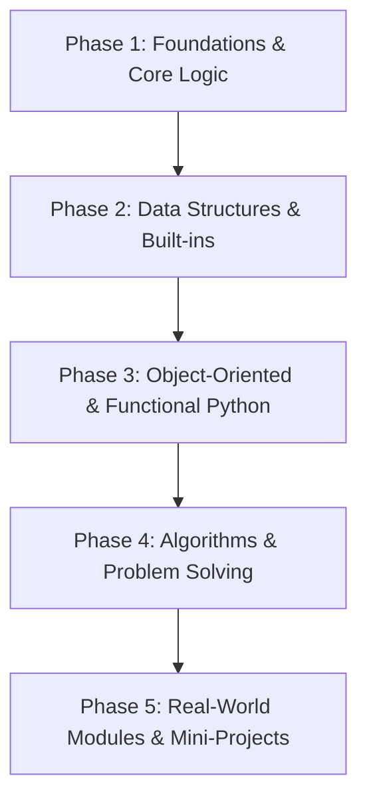

<div align="center">

# 🐍 Way to Python — Zero to Mastery
### *A Daily Commitment to Mastering Python from Fundamentals to Advanced Engineering*

[](https://www.python.org/)
[](https://github.com/shriyash2006/Way-to-Python)
[](https://github.com/shriyash2006/Way-to-Python/commits/main)
[](https://opensource.org/licenses/MIT)
[](https://github.com/shriyash2006)

<p align="center">
  <b>"The best way to learn to code is to code every single day."</b><br>
  Welcome to my documented journey of learning, writing, and mastering Python from absolute basics to production-ready engineering, data structures, and algorithms.
</p>

[📌 Daily Tracker](#-daily-progress-tracker) •
[🗺️ Roadmap](#️-python-mastery-roadmap) •
[⚡ Quick Start](#-quick-start) •
[🤖 Automated Workflow](#-automated-daily-workflow) •
[🤝 Connect](#-connect--contribute)

---

</div>

## 📊 Journey Overview & Live Stats

| Metric | Details |
| :--- | :--- |
| 🎯 **Goal** | Master Python core concepts, standard library, OOP, DSA, and practical scripts |
| 📅 **Commitment** | Daily code practice + documentation + GitHub commit |
| 📁 **Repository** | [shriyash2006/Way-to-Python](https://github.com/shriyash2006/Way-to-Python.git) |
| 🏷️ **Current Phase** | **Phase 1: Python Core & Foundations** |
| ⏱️ **Started** | October 2026 |

---

## 📌 Daily Progress Tracker

> Every day's learning is logged here with code references, key concepts learned, and current status.

| Day | Date | Topic | Key Concepts | Code | Status |
| :--- | :--- | :--- | :--- | :--- | :--- |
| **Day 01** | 2026-10-21 | **Bitwise Operators & Manipulation** | `AND, OR, XOR, NOT, Shifts, Bitmasks, Brian Kernighan` | [D1 Bitwise.py](./D1%20Bitwise.py) | ✅ Completed |
<!-- DAILY_TRACKER_ROWS -->

---

## 🗺️ Python Mastery Roadmap



### 🔹 Phase 1: Foundations & Core Syntax (Days 01 - 15)
- [x] **Day 01:** Bitwise Operators (`&`, `|`, `^`, `~`, `<<`, `>>`) & Binary Logic
- [ ] **Day 02:** Variables, Primitive Data Types & Dynamic Typing
- [ ] **Day 03:** Conditional Statements, Match-Case & Logical Flow
- [ ] **Day 04:** Loops (`for`, `while`, `break`, `continue`, `else` with loops)
- [ ] **Day 05:** Number Systems, Math Module, and Numeric Operations
- [ ] **Day 06:** String Operations, Slicing, Methods, and `f-strings`
- [ ] **Day 07:** Functions, Default Arguments, `*args`, and `**kwargs`
- [ ] **Day 08:** Scope Resolution (LEGB Rule) & Global Keyword
- [ ] **Day 09:** Lambda Functions, Map, Filter, and Reduce
- [ ] **Day 10:** Exception Handling (`try`, `except`, `else`, `finally`, custom exceptions)

### 🔹 Phase 2: Data Structures & Built-ins (Days 16 - 30)
- [ ] Lists & List Comprehensions (In-depth indexing, memory behavior)
- [ ] Tuples & Immutability Patterns
- [ ] Dictionaries, Dict Comprehensions, and Hash Maps
- [ ] Sets, Frozen Sets, and Set Theory Operations
- [ ] Built-in Collections (`deque`, `Counter`, `defaultdict`, `namedtuple`)
- [ ] Iterators, Iterables, and Generators (`yield` expressions)

### 🔹 Phase 3: OOP & Intermediate Concepts (Days 31 - 50)
- [ ] Classes, Objects, and `__init__` constructor
- [ ] Instance, Class (`@classmethod`), and Static Methods (`@staticmethod`)
- [ ] The 4 Pillars: Encapsulation, Abstraction, Inheritance, and Polymorphism
- [ ] Dunder / Magic Methods (`__repr__`, `__str__`, `__len__`, `__eq__`, etc.)
- [ ] Decorators & Function Wrappers (`functools.wraps`)
- [ ] Context Managers (`with` statement, `__enter__`, `__exit__`)
- [ ] File I/O (Text, Binary, JSON, CSV processing)

### 🔹 Phase 4: Algorithms & Problem Solving (Days 51 - 75)
- [ ] Recursion & Backtracking Fundamentals
- [ ] Searching Algorithms (Linear & Binary Search variations)
- [ ] Sorting Algorithms (Merge Sort, Quick Sort, Timsort)
- [ ] Two-Pointers & Sliding Window Patterns
- [ ] Stacks, Queues, and Priority Queues (`heapq`)
- [ ] Basic Trees, Graphs, and Dynamic Programming in Python

### 🔹 Phase 5: Applied Python & Projects (Days 76+)
- [ ] Working with APIs & `requests`
- [ ] Web Scraping (`BeautifulSoup`, `playwright`)
- [ ] Concurrency (`threading`, `multiprocessing`, `asyncio`)
- [ ] CLI Application Development (`argparse`, `click`, `rich`)
- [ ] Capstone Portfolio Projects

---

## ⚡ Quick Start

### 1. Clone the Repository
```bash
git clone https://github.com/shriyash2006/Way-to-Python.git
cd Way-to-Python
```

### 2. Run Day 1 Code
```bash
python3 "D1 Bitwise.py"
```

---

## 🤖 Automated Daily Workflow

This repository includes a dedicated automation script [scripts/daily_logger.py](./scripts/daily_logger.py) and an Antigravity Workspace Skill [SKILL.md](./SKILL.md) to streamline daily commits and README updates.

### Option A: Interactive Mode
Whenever you finish your day's coding, run:
```bash
python3 scripts/daily_logger.py
```
*It will prompt you for the day number, topic name, code file, and key concepts, automatically update this README table, create a clean git commit, and push directly to GitHub!*

### Option B: One-Liner Command
```bash
python3 scripts/daily_logger.py --day 2 --topic "Variables & Data Types" --file "D2_Variables.py" --concepts "int, float, str, type casting, memory ids"
```

### 🏷️ Git Commit Standards
Every commit adheres to conventional commit guidelines:
```text
feat(day-01): bitwise operators and binary manipulation
feat(day-02): variables, type casting and memory model
docs(readme): update daily progress tracker table
```

---

## 📁 Repository Structure

```text
Way to Python/
│
├── .agents/
│   └── skills/
│       └── python-daily-tracker/
│           └── SKILL.md             # Antigravity skill configuration
│
├── scripts/
│   └── daily_logger.py             # Automatic tracker & GitHub sync tool
│
├── D1 Bitwise.py                   # Day 01: Bitwise operators & binary manipulation
├── README.md                       # Impressive daily progress & roadmap
├── SKILL.md                        # Quick reference skill for AI assistant
└── .gitignore                      # Python ignores (pycache, envs, IDEs)
```

---

## 🤝 Connect & Contribute

- **Author**: Shriyash Sahu
- **GitHub**: [@shriyash2006](https://github.com/shriyash2006)
- **Repository**: [Way to Python](https://github.com/shriyash2006/Way-to-Python)

⭐ **If you find this learning repository inspiring or helpful, please consider leaving a Star on GitHub!**
