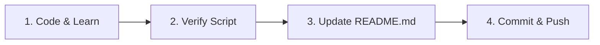

# Python Daily Learning & GitHub Auto-Sync Skill

A standardized workflow runbook for tracking daily Python learning from absolute basics to advanced software engineering, maintaining a live progress tracker in `README.md`, and pushing daily commits to [GitHub repository](https://github.com/shriyash2006/Way-to-Python.git).

---

## 🎯 Daily Workflow Overview

Every day's session follows a 4-step pipeline:



---

## 📁 File Naming Conventions

Maintain consistent and readable file names for each day's code:
- **Format:** `D<DayNumber> <Topic>.py` (or `D<DayNumber>_<Topic>.py`)
- **Examples:**
  - `D1 Bitwise.py`
  - `D2 Variables_DataTypes.py`
  - `D3 Conditionals.py`
  - `D4 Loops.py`

### Python File Template
Every daily Python script must include:
1. Header docstring with Day, Topic, Date, and Description.
2. Modular demo functions with clear print outputs.
3. LeetCode / practical interview trick or application.
4. `if __name__ == "__main__":` entry point.

---

## 🚀 Execution Methods

### Method 1: Automated Script (Recommended)

Run the bundled logger script:
```bash
python3 scripts/daily_logger.py
```
Or with CLI arguments:
```bash
python3 scripts/daily_logger.py --day <DAY_NUMBER> --topic "<TOPIC_NAME>" --file "<FILENAME.py>" --concepts "<CONCEPTS_LIST>"
```

**What the script does automatically:**
1. Inserts or updates the row in `README.md` under `<!-- DAILY_TRACKER_ROWS -->`.
2. Updates the `Days Completed` badge count in `README.md`.
3. Stages changes with `git add .`.
4. Creates a conventional git commit (e.g., `feat(day-02): variables & data types practice`).
5. Pushes to `origin main` on GitHub.

---

### Method 2: Manual Step-by-Step Procedure

If you prefer to perform the steps manually or customize the entry:

#### Step 1: Update `README.md`
1. Open [README.md](./README.md).
2. Locate `<!-- DAILY_TRACKER_ROWS -->`.
3. Add a new row above the marker:
   ```markdown
   | **Day XX** | YYYY-MM-DD | **<Topic Name>** | `<Key Concepts>` | [<FileName>.py](./<FileName>.py) | ✅ Completed |
   ```
4. If the topic completes a roadmap milestone in [README.md](./README.md), mark the corresponding checkbox from `[ ]` to `[x]`.
5. Update the shield badge if needed:
   ```markdown
   [: <topic_name> practice & notes"
```

#### Step 3: Push to GitHub
```bash
git push -u origin main
```

---

## 🏷️ Commit Message Standard

Always use conventional commits:

| Type | Format | Example |
| :--- | :--- | :--- |
| **New Day** | `feat(day-XX): <topic> practice & notes` | `feat(day-02): primitive types and memory model` |
| **Documentation** | `docs(readme): update daily progress tracker` | `docs(readme): add day 03 tracker and roadmap items` |
| **Refactoring** | `refactor(day-XX): improve solution efficiency` | `refactor(day-01): add Kernighan algorithm comments` |
| **Fixes** | `fix(day-XX): fix typo or logic edge case` | `fix(day-04): fix infinite loop boundary condition` |

---

## 🧪 Verification & Health Checks

Before concluding each daily session:
1. **Execute the script:**
   ```bash
   python3 "D<DayNumber> <Topic>.py"
   ```
   *Ensure exit code is 0 and output is clean and self-explanatory.*
2. **Check Git Status:**
   ```bash
   git status
   ```
   *Ensure working tree is clean and `origin/main` is up to date.*
3. **Inspect GitHub URL:**
   Visit: `https://github.com/shriyash2006/Way-to-Python` to view the updated README and commit history.
